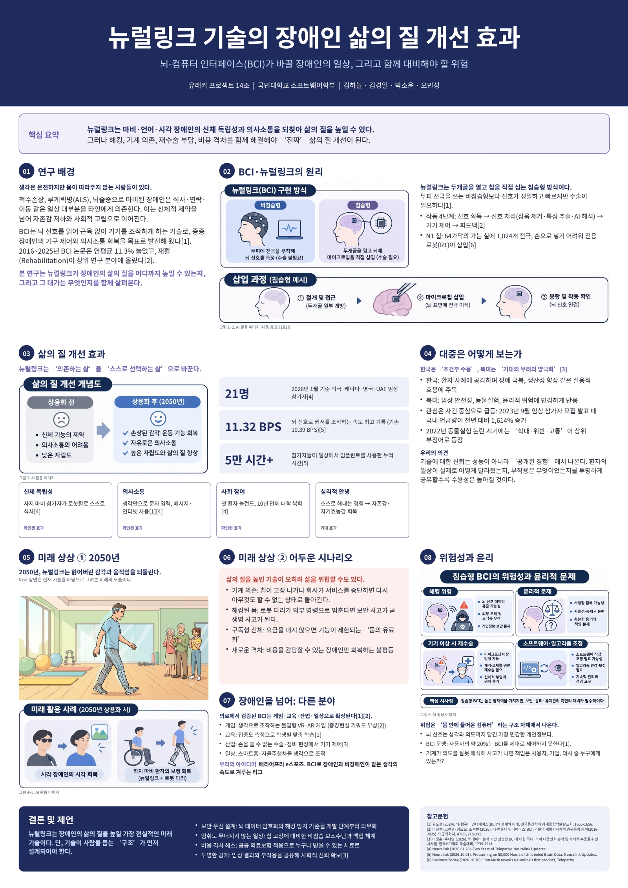

# Welcome to E26-SW01-14

## 🎯 팀 슬로건

> <b>"즐겁게 살자!"<b/>

## 🖼️ 팀 포스터

<div class="poster"></div>

<p align="center" class="poster-caption"><sub>뉴럴링크 기술의 장애인 삶의 질 개선 효과 팀 포스터 <br> 출처: 유레카 프로젝트 14조(김하늘·김경일·박소윤·오인성)</sub></p>

1965년에 35년 뒤의 생활을 상상해 그린 이 그림처럼, 우리 팀이 그리는 미래를 포스터로 만들어 봅시다.
팀 활동으로 만든 포스터를 `poster.jpg` 파일 이름으로 이 repository에 업로드하면 위 그림이 팀 포스터로 바뀝니다.
파일 이름이 다르거나 png 파일이면 위 ``의 파일 이름을 맞추고, 출처 문구도 팀에 맞게 고쳐 주세요.

> **포스터 파일 권장 규격**: A4 세로 비율(1 : 1.414), 1240×1754px 이상, JPG, 2MB 이하.
> 홈페이지에서는 어떤 크기·비율의 파일을 올려도 같은 크기의 세로 틀 안에 맞춰 표시되지만, 권장 규격을 지키면 여백 없이 가장 선명하게 보입니다.

***

## 1️⃣ 팀원 소개

| **이름** | **전공** | **관심사** |
| --- | --- | --- |
| **박소윤** | 한국역사학과 | 웹 개발, 역사, 다도 |
| **김하늘** | 소프트웨어전공 | 임베디드, 컴퓨터, 퍼즐 |
| **오민성** | 소프트웨어전공 | 게임 |
| **김경일** | 소프트웨어전공 | 보안, 임베디드, 헬스, AI |

유레카프로젝트 팀 생성을 축하합니다.
팀의 제목과 슬로건, 팀원의 이름 및 관심사를 변경하세요.

### 팀 소개

팀의 소개를 작성합니다.

***

## 2️⃣ 공통된 관심사 : IT 및 개발 분야

웹 개발, 컴퓨터, AI, 게임 등

***

## 3️⃣ 한학기 동안의 활동 내역 

- 기관/부서 인터뷰 ✔️  

- 현장 탐방 ✔️  

- 멘토링 ✔️  
  - 내 지도 교수 함게 만나기
  - 대학원 방문 및 선배 만나기

- 프로젝트 진행 ✔️  
  - 과거에 사람들이 상상한 미래
    - 과거 사례 4분류 및 근거 작성
      <table>
        <thead>
          <tr>
            <th width="95">분류</th>
            <th>사례 및 분류 근거</th>
          </tr>
        </thead>
        <tbody>
          <tr>
            <td width="95";><strong>실현</strong></td>
            <td>
              • <strong>전기 자동차</strong>: 테슬라 등 여러 자동차 브랜드에서 전기 자동차 상용화함.<br>
              • <strong>스마트 부엌</strong>: IoT 기술로 냉장고, 인덕션 등의 가전을 연결하여 원격 사용 등이 가능.<br>
              • <strong>원격 학습 / 원격 진료</strong>: 줌과 같은 실시간 화상 통화를 이용한 학습 및 진료 가능.<br>
            </td>
          </tr>
          <tr>
            <td width="95"><strong>일부 실현</strong></td>
            <td>
              • <strong>청소 로봇</strong>: 로봇 청소기가 존재하지만 휴머노이드 청소 로봇은 아직 미구현.<br>
              • <strong>움직이는 도로</strong>: 지하철역이나 공항에는 무빙워크가 많이 있지만, 도시나 시내에서는 활성화 되어 있지 않음.
            </td>
          </tr>
          <tr>
            <td width="95"><strong>미실현</strong></td>
            <td>
              • <strong>달나라 수학여행</strong>: 이론적으로 가능하고, 달 착륙에 성공한 사례는 있지만 금전적 문제나 위험성 등으로 인해 현실적으로 상용화되어 있지 않음.
            </td>
          </tr>
          <tr>
            <td width="95"><strong>방향 전환</strong></td>
            <td>
              • <strong>소형 TV / 전화기</strong>: 스마트폰으로 대체되어 실현됨.
            </td>
          </tr>
        </tbody>
      </table>
      <br>
     - Why-What-How-Next 심층 분석
       <table>
         <tr>
           <th width= "95">선택 사례</th>
           <th>전기 자동차</th>
         </tr>
         <tr>
           <td>WHY</td>
           <td>1960년대 초반에 대도시의 스모그와 배기가스 등 대기 오염 문제가 사회적 문제로 대두되면서, 이에 대한 친환경적인 해결책이 논의됨. </td>
         </tr>
         <tr>
           <td>WHAT</td>
           <td> • 자율주행과 이동의 자유 <br>: 운전자가 직접 운전하지 않아도 차량이 스스로 운전. 노인, 장애인, 비면허자 등 누구나 자유롭게 이동 가능<br><br>
              • 공간의 재정의 <br>: 자동차가 단순 이동 수단을 넘어 차 안에서 휴식, 업무, 여가를 즐길 수 있는 ‘제2의 생활 공간’<br><br>
              • 지능형 교통 및 커넥티비티 <br>: 차량 간 네트워크를 통해 서로 정보 주고받아 최적의 경로로 이동함으로써 교통체증과 사고를 최소화하는 시스템<br><br>
              • 완전 자동화 서비스 <br>: 필요할 때 호출하면 스스로 찾아오는 무인 로보택시, 차를 개인이 소유하지 않고 공유해 쓰는 서비스, 전기차와 결합하여 스스로 충전까지 마치는 자동화된 모빌리티 생태계</td>
         </tr>
         <tr>
           <td>HOW</td>
           <td>  • 고용량 리튬이온 배터리, 고성능 전기 모터, AI 카메라·라더·레이더 센서, 그리고 FSD(Full Self-Driving) 등 자율주행 SW 기술의 고도화를 통해 테슬라(Tesla)와 같은 고성능·장거리 주행 전기차가 상용화.
             <br><br> •  다만 완전 자율주행(레벨 4~5)은 운전자의 개입이 완전히 배제된 단계까지는 이르지 못해 부분 자율주행 형태 및 지정 구역 로보택시 실증 단계로 구현.</td>
         </tr>
         <tr>
           <td>NEXT</td>
           <td>  • 기술적·환경적 한계 <br>: 여전한 충전 인프라 부족, 긴 충전 시간 문제, 배터리 원자재 조달 및 폐배터리 처리 문제(ESG 이슈)가 존재 <br><br>
              • 사회적·윤리적 과제 <br>: 돌발 상황에서의 완전자율주행 안전성 확보 문제, 사고 발생 시 책임 소재(제조사 vs 운전자) 불분명성, 해킹 위험 등 사이버 보안 문제, 그리고 기술 보급 과정에서의 차량 가격 및 접근성 격차가 새로운 과제로 대두</td>
         </tr>
       </table>
      <br>
    
  - 그들이 만들어가는 세상
    - 대학 생활 중 느낀 불편을 AI와 함께 다시 쓰기 <br>
    
      
      
      > 최종 선택 아이디어 : 학식 메뉴별 실시간 재고 안내 <br>
      > 선정 이유 <br>: 대학생들이 일상에서 겪는 불편함을 가장 즉각적이고 실용적으로 해결할 수 있으며, 교내 POS 시스템 연동이라는 현실적인 실현 가능성을 가지고 있기 때문.
    <br>
    
  - 우리가 상상한 미래
    - 미래 서비스 캔버스
      <table>
        <tr>
          <th width="95">항목</th>
          <th>내용</th>
        </tr>
        <tr>
          <td>핵심<br>사용자</td>
          <td> • 페르소나 <br>경추 손상이나 루게릭병 등, 목 아래 전신 마비 상태를 겪고 있어 손발이나 말을 이용해 디지털 기기 조작이 어려운 중증 지체/언어 장애인.<br><br>
             • 사용자 특징 <br>보호자나 마우스 스틱 등의 외부 도움 없이는 컴퓨터, 스마트폰, 휠체어 조작이 불가능하여 디지털 접근성과 삶의 자율성이 크게 제한됨.</td>
        </tr>
        <tr>
          <td>사용 상황</td>
          <td> • 발생 상황 
            <br>- 침상에 혼자 있거나 보호자가 자리를 비운 경우
            <br>- 급히 메시지를 보내거나 인터넷 검색/학습/업무/엔터테인먼트(게임, 영상 시청 등)를 하고 싶은 순간.<br><br>
             • 발생 장소 : 가정, 전동 휠체어 이동 중, 병원 침상 등</td>
        </tr>
        <tr>
          <td>현재의<br>불편</td>
          <td>기존 방식의 한계 <br>: 입에 물고 쓰는 터치 스틱이나 눈동자 추적 장치는 목과 턱에 극심한 통증과 피로 유발함.</td>
        </tr>
        <tr>
          <td>미래의<br>변화</td>
          <td>일상의 변화 <br>: 신체적 움직임 없이 오직 생각만으로 마우스 커서를 제어하고 텍스트를 입력하여 작성, 3D 모델링, 코딩, 게임 등을 자유롭게 수행함.</td>
        </tr>
        <tr>
          <td>핵심 경험</td>
          <td> • “손을 움직인다”고 생각하면, 화면의 마우스 커서가 즉시 의도한대로 부드럽게 움직이고, 클릭됨.<br>
             • 머릿속으로 떠올린 문장이나 목소리가 타인의 도움 없이 즉각 디바이스에 입력되거나 스피커로 출력됨.</td>
        </tr>
        <tr>
          <td>필요한<br>기술</td>
          <td>AI & 신경 신호 분석 <br>: 뇌 유전자/전기 신호를 실시간으로 해석 및 디코딩하여 마우스/키보드 명령어로 변환하는 AI 디코딩 알고리즘</td>
        </tr>
        <tr>
          <td>남은 위험</td>
          <td> • 윤리적 문제 <br> 뇌 해킹 및 ‘뇌 데이터’ 유출 시 개인의 생체/생각 데이터 프라이버시 침해 우려
             <br><br>• 실현 가능성의 의학적/기술적 한계
            <br>-장기 이식 시 생체 적합성 이슈
            <br>-배터리 충전 방식의 안전성 검증</td>
        </tr>
      </table>
      <br>
    - 미래 장면 시각화 자료<br>
      
      <br><br>
    - 벤치마킹 출처<br>
       • <a href="https://www.mk.co.kr/news/world/12179526" target="_blank" rel="noopener noreferrer">매일경제 플러스 「머스크도 웃지 못한 뉴럴링크 상용화, 중국은 어떻게 뚫어냈나</a><br>
       • <a href="https://www.dongascience.com/ko/news/63582" target="_blank" rel="noopener noreferrer">The Science Times 뉴스레터 「일론 머스크의 뉴럴링크, 인간 뇌 최초 칩 이식에 성공하다</a><br>
       • <a href="https://www.newsspace.kr/news/article.html?no=14598" target="_blank" rel="noopener noreferrer">NS  뉴스 스페이스 빅테크 칼럼 「머스크의 뉴럴링크, 뇌 보호막을 절개하지 않고 최초로 전극 삽입 성공... BCI 상용화의 게임 체인저 될까</a><br>
       • <a href="https://youtu.be/jEWGsLAZRb0?si=39MRGUMVMiDksKx4" target="_blank" rel="noopener noreferrer">KBS News 유튜브 「생각만으로 체스를... 뇌에 ‘뉴럴링크 칩’ 이식 환자 첫 공개</a><br> 
      <br>
    - 역할 분담 메모
      <table>
        <tr>
          <th>조원</th>
          <th>역할</th>
        </tr>
        <tr>
          <td>박소윤</td>
          <td>관련 자료 조사 및 정리</td>
        </tr>
        <tr>
          <td>김하늘</td>
          <td>포스터 제작</td>
        </tr>
        <tr>
          <td>오민성</td>
          <td>발표</td>
        </tr>
        <tr>
          <td>김경일</td>
          <td>아이디어 제공 및 시각화 자료 제작</td>
        </tr>
      </table>
    <br>
    
  - 우리가 그리는 미래 그리고 나

- 각오와 소감 나누기 ✔️  


<!-- 활동 사진 추가 예시 -->


***

## 4️⃣ 인상 깊은 활동

- 활동명 – 활동에 대한 간단한 설명과 배운 점을 작성  
- 예: 멘토링에서 실리콘밸리 현업 경험을 들을 수 있어 진로 방향 설정에 큰 도움이 되었다.  

***

## 5️⃣ 특별히 알아보고 싶은 것
- 예: 현장실습 제도
- 예: 학부 졸업 인증 조건
- 예: 성취기반평가
- 예: 졸업 후 진로(대학원/취업)

***

## 6️⃣ 활동을 마친 소감

🔗학번 박소윤  
> "소감 내용을 여기에 작성합니다."

🔗학번 이하늘  
> "소감 내용을 여기에 작성합니다."

🔗학번 오민성  
> "소감 내용을 여기에 작성합니다."

🔗학번 김경일  
> "소감 내용을 여기에 작성합니다."


## Markdown을 사용하여 내용꾸미기를 익히세요.

Markdown은 작문을 스타일링하기위한 가볍고 사용하기 쉬운 구문입니다. 여기에는 다음을위한 규칙이 포함됩니다.

```markdown
Syntax highlighted code block

# Header 1
## Header 2
### Header 3

- Bulleted
- List

1. Numbered
2. List

**Bold** and _Italic_ and `Code` text

[Link](url) and 
```

자세한 내용은 [GitHub Flavored Markdown](https://guides.github.com/features/mastering-markdown/).

### Support or Contact

readme 파일 생성에 추가적인 도움이 필요하면 [도움말](https://help.github.com/articles/about-readmes/) 이나 [contact support](https://github.com/contact) 을 이용하세요.

